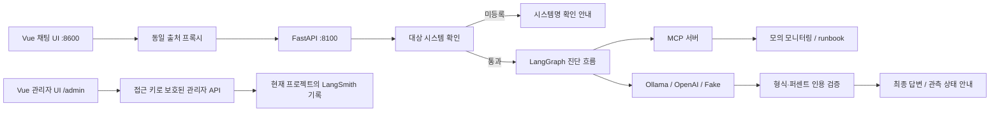

# Incident Response Agent

서비스 장애 진단을 돕는 AI Agent입니다. 사용자의 요청에 따라 모니터링 데이터와 장애 대응 매뉴얼(runbook)을 조회하고, 확인된 상태와 추가 점검 사항을 안내합니다.

SKALA AI Mini-Project의 **1번 과제: 제공된 Base AI Agent 개선**으로 진행 중입니다. 이 저장소는 제공된 `all_total_vue_student`를 기반으로 하며, 아래에 기존 구성과 이번 프로젝트의 개선 사항을 구분했습니다.

모니터링은 실제 운영 서비스가 아닌 `data/monitoring.json` 기반의 모의 데이터입니다. CPU·메모리에는 호출마다 변동값이 추가됩니다. 서비스 재시작·확장·롤백을 실행하는 기능은 없습니다.

## 개선한 문제

| 문제 | 개선 내용 | 확인 상태 |
|---|---|---|
| `billing-service`를 요청하면 등록된 `auth-service`로 대체해 진단 | 명시된 미등록 시스템을 진입 단계에서 검사하고 이름 확인 요청으로 종료 | 자동 테스트 및 Ollama 화면 확인 |
| 매뉴얼의 점검 지시를 이미 확인한 결과처럼 답변 | 관측 결과·미실행 매뉴얼·모델 추정을 구분하고 로그/지속시간 미확인을 표시하도록 작성 지시 공통화 | Ollama 사례 1건에서 기대 동작 관찰 |
| 길이·번호만 맞으면 근거 없는 수치도 검증 통과 | 근거에 존재하지 않는 퍼센트 인용을 반려하고 재작성 피드백 전달 | 고정 합성 사례 및 자동 테스트 |
| 검증 3회 실패 후 초안을 강제 합격 처리 | 합격시키지 않고 수집된 상태만으로 최종 안내 구성 | 일반/스트리밍 API 자동 테스트 |
| 상태 변경 없는 노드에서 스트리밍 중단 | `None` 업데이트를 건너뛰어 응답 스트림 유지 | 자동 테스트 및 Ollama 화면 확인 |
| 사용자 채팅에서 내부 프롬프트 노출, 별도 관리자 화면 부재 | 관리자 접근 키로 보호된 LangSmith 요청 목록·상세·검증 이력 화면 추가, 사용자 응답에서 프롬프트 분리 | 로컬 모의 화면/API 테스트 및 실제 LangSmith 저장·조회 확인 |

첫 개선은 커밋 `6f18c2c`에 포함되어 있습니다. 개선 전 기준 코드는 최초 커밋 `0672d14`입니다.

## 서비스 구조



- **기존 제공 구성:** Vue UI, FastAPI API, LangGraph의 계획·조사·재계획·분석 흐름, MCP Tool/Resource/Prompt, SSE 스트리밍, SQLite 세션 저장, LLM 백엔드 교체, LangSmith 추적 코드.
- **이번 개선:** 대상 확인, 근거 종류 구분, 퍼센트 인용 검사, 검증 실패 시 대체 응답, 빈 스트림 업데이트 처리, 관리자 화면 및 사용자/관리자 프롬프트 분리, 회귀 테스트.
- **출처 처리:** 브라우저는 같은 출처의 프록시로 요청하고, 프록시가 백엔드로 전달합니다. 포트가 다른 백엔드를 브라우저가 직접 호출하는 구조가 아닙니다.
- **관리자 관측:** 일반/스트리밍 요청을 각각 루트 추적으로 묶고, 처리 시간·누적 토큰·검증 결과·추정 비용을 조회합니다. 내부 프롬프트와 실행 트리는 관리자 상세에서 확인합니다.

## 로컬 실행

Python과 Ollama가 설치되어 있어야 합니다. Python 3.11 환경에서 테스트했습니다. 프론트엔드는 Vue CDN을 사용하므로 별도 npm 빌드는 필요하지 않습니다.

### 1. 저장소와 패키지 준비

```bash
git clone https://github.com/jij0128/incident-response-agent.git
cd incident-response-agent
bash sh/setup_venv.sh
cp -n .env.example .env
```

처음에는 `.env`에서 다음과 같이 설정하면 LangSmith 키 없이 로컬 실행을 확인할 수 있습니다.

```dotenv
LANGCHAIN_TRACING_V2=false
```

추적을 사용할 때는 `LANGCHAIN_TRACING_V2=true`로 변경하고 본인의 `LANGCHAIN_API_KEY`를 설정합니다. 실제 키는 `.env`에만 넣습니다.

### 2. Ollama 모델 준비 및 백엔드 실행

```bash
bash sh/setup_ollama.sh
bash sh/run_agent_ollma.sh
```

기본 모델은 `qwen3:0.6b`와 `qwen3:8b`이며 처음에는 모델 다운로드가 필요합니다. 백엔드가 실행된 터미널은 켜둡니다.

### 3. 다른 터미널에서 화면 실행

프로젝트 폴더로 이동한 뒤 실행합니다.

```bash
bash sh/run_frontend.sh
```

브라우저에서 [http://localhost:8600](http://localhost:8600)에 접속합니다. 종료는 각 실행 터미널에서 `Control+C`를 누릅니다.

제공된 실행 스크립트는 시작 시 해당 포트의 기존 프로세스를 종료하며, 백엔드 스크립트는 `session.db`를 삭제해 이전 대화 기록을 초기화합니다. 모델 준비 스크립트도 실행 중인 Ollama 서버를 재시작합니다.

### OpenAI 백엔드

`.env`에 본인의 `OPENAI_API_KEY`를 설정한 뒤 로컬 백엔드를 종료하고 실행합니다. 실제 API 비용이 발생하며 실행 시 확인을 받습니다.

```bash
bash sh/run_agent_openai.sh
```

이번 개선의 OpenAI 호출부는 테스트용 응답으로 검증했습니다. 실제 OpenAI 모델 호출을 이용한 최종 확인은 아직 진행하지 않았습니다.

## 관리자 화면

백엔드와 프론트엔드가 모두 실행된 상태에서 [http://localhost:8600/admin](http://localhost:8600/admin)에 접속합니다. `.env`의 `ADMIN_API_TOKEN`으로 인증해야 요청 데이터를 볼 수 있습니다. 키는 브라우저 저장소나 URL에 저장하지 않고 요청 헤더로 전달합니다.

관리자 접근 키가 없다면 로컬에서 아래 명령으로 생성한 값을 `.env`의 `ADMIN_API_TOKEN`에 설정합니다. 키를 바꾼 뒤에는 백엔드를 재시작합니다.

```bash
python3 -c 'import secrets; print(secrets.token_urlsafe(32))'
```

- 최근 20개 요청과 완료 요청 평균 처리 시간, 기록된 토큰 합계를 표시합니다.
- 상세 보기에서 최종 답변, 검증 반려/재시도 이력, 실행 트리, 최종 프롬프트를 확인합니다.
- 현재 환경변수의 LangSmith 프로젝트만 조회합니다. 다른 프로젝트의 추적 ID나 하위 실행 ID를 직접 요청하면 거절합니다.
- 관리자의 LangSmith 조회 실패는 안내 메시지로 반환하며 사용자 채팅의 진단 경로와는 분리됩니다.

추적 기록에는 테스트 질문·답변·프롬프트·실행 정보가 외부 LangSmith 계정으로 전송됩니다. 이 전송 범위를 확인한 뒤 유효한 LangSmith 키와 `LANGCHAIN_TRACING_V2=true`를 설정해 사용합니다. 추적을 켜기 전의 과거 대화는 소급 기록되지 않습니다. 기본 실행 스크립트는 프로젝트를 백엔드에 따라 `capstone-all-total-ollama` 또는 `capstone-all-total-openai`로 지정합니다.

관리자 기능은 모의 응답을 이용한 로컬 화면/API 검증과 실제 LangSmith 저장·조회 통합 검증을 마쳤습니다. 2026-10-20 사용자 승인 아래 `capstone-all-total-admin-check` 프로젝트에 모의 일반 요청과 SSE 요청을 각각 1건 기록했습니다. 각 요청에서 추정 토큰 217개, 실행 노드 42개, 검증 반려 후 재작성·합격 이력을 조회했습니다. 토큰 값은 Fake 백엔드의 문자열 길이 추정치이며 실제 LLM 사용량이 아닙니다. 외부 모델은 호출하지 않았고 일반 채팅의 추적 설정은 변경하지 않았습니다.

## 사용 예시

등록된 시스템 진단:

```text
payments-service 결제 응답이 느려지고 CPU가 치솟았어요, 원인 확인해주세요.
```

확인된 사실, 추가 확인 사항, 조건부 권고를 구분해 답변하도록 구성했습니다.

미등록 시스템 확인:

```text
billing-service 응답이 느려요. 원인 확인해주세요.
```

기대 답변:

```text
`billing-service`는 등록된 모니터링 대상에서 찾을 수 없습니다. 시스템명을 확인해주세요.
```

등록된 대상은 `auth-service`, `web-01`, `payments-service`, `cache-service`, `gateway-service`, `log-service`입니다.

## 검증 결과

```bash
LANGCHAIN_TRACING_V2=false LANGSMITH_TRACING=false .venv/bin/python3 -m unittest discover -s tests -v
```

현재 자동 테스트 **23개 통과**. 외부 모델과 LangSmith 서버를 호출하지 않고 테스트용 응답으로 검증합니다. 미등록·혼합 대상 처리, 등록 대상 진단, 채팅 및 SSE 응답 완료, 수치 반려, 최대 재시도 후 대체 응답, 두 백엔드의 근거 구분 지시, 관리자 인증·프로젝트 소속 검사·프록시 오류 처리·내부 프롬프트 분리를 확인합니다.

동일한 고정 합성 답변을 기존 형식 검사와 변경된 검사에 적용한 비교입니다.

| 비교 대상 | 기존 검사 통과 | 변경 후 검사 통과 |
|---|---:|---:|
| CPU 95.9%를 99.9%/100%/53.5%로 바꾼 오답 3건 | 3/3 | 0/3 |
| 정확한 수치를 인용한 답변 1건 | 1/1 | 1/1 |

이는 **검증 규칙의 합성 사례 비교**이며 실제 모델 정확도나 응답시간 개선을 측정한 결과가 아닙니다.

2026-10-20 Ollama 실제 화면에서는 미등록 대상 확인과 등록 대상 진단을 확인했습니다. 개선 후 답변 한 건에서 현재 CPU 94.2%와 알림의 91%를 구분하고, 로그·지속시간·배포 이력을 미확인으로 표시하며 조치를 조건부로 권고했습니다. 한 건의 관찰 결과이므로 일반적인 정확도 보장으로 확대하지 않습니다.

## 한계와 배운 점

- **대상 확인 범위:** `-service`/`_service`를 포함한 식별자와 숫자 접미사 호스트명을 검사합니다. 자연어 별칭과 대상명 생략 시 기본 대상 선택은 개선하지 않았습니다. 이번 개선은 v2 그래프에 적용됩니다.
- **수치 검사 범위:** 퍼센트 수치의 출처 존재 여부를 확인합니다. 잘못된 시스템/지표 귀속, 초·시간 등 다른 단위, 자연어 주장까지 자동 검증하지 않습니다.
- **매뉴얼과 관측의 차이:** 작성 지시로 구분을 유도했으며 모델이 항상 지시를 따른다고 보장하지 않습니다. 로그·시계열 데이터 수집 도구는 아직 없습니다.
- **스트리밍:** 최종 검증 전에 초안이 화면에 노출될 수 있습니다. 내부 프롬프트는 사용자 응답에서 제외하고 인증된 관리자 상세로 분리했습니다.
- **관리자 기능:** 단일 접근 키를 사용하는 로컬 실습용 구성입니다. 사용자별 계정/역할 관리는 없으며 공개 운영용 인증 체계를 완성한 것은 아닙니다. 실행 트리 표시는 200개로 제한하고, 기존 추적에 새 지표가 없으면 기록 없음으로 표시합니다. LangSmith 전송과 조회 사이에는 반영 지연이 있을 수 있습니다.
- **비용과 비교:** 로컬 모의 데이터에는 변동이 있습니다. 실제 모델의 개선 전후 비교에는 같은 데이터와 입력을 고정해야 합니다. 코드의 `cost_usd`는 단순화된 가상 단가 계산이므로 실제 청구 금액과 다릅니다.
- **교훈:** 확인 노드를 추가했을 때 상태 변경 없는 결과가 `None`으로 전달되어 스트리밍이 끊어졌습니다. 그래프 단위 검사뿐 아니라 실제 화면이 사용하는 SSE API까지 회귀 테스트해야 함을 확인했습니다.

## 상세 문서

- [제공된 베이스 프로젝트 설명](doc/README.md)
- [회귀 테스트 질문 및 개선 확인 기록](doc/regression_test_queries.md)
- [Ollama 사용 안내](doc/manual_ollma.md)
- [OpenAI 사용 안내](doc/manual_openai.md)
- [자동 테스트](tests/)
