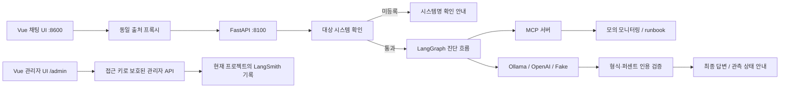

# Incident Response Agent

서비스 장애 진단을 돕는 AI Agent입니다. 사용자의 요청에 따라 모니터링 데이터와 장애 대응 매뉴얼(runbook)을 조회하고, 확인된 상태와 추가 점검 사항을 안내합니다.

SKALA AI Mini-Project의 **1번 과제: 제공된 Base AI Agent 개선**으로 진행 중입니다. 이 저장소는 제공된 `all_total_vue_student`를 기반으로 하며, 아래에 기존 구성과 이번 프로젝트의 개선 사항을 구분했습니다.

모니터링은 실제 운영 서비스가 아닌 `data/monitoring.json` 기반의 모의 데이터입니다. CPU·메모리에는 호출마다 변동값이 추가됩니다. 서비스 재시작·확장·롤백을 실행하는 기능은 없습니다.

결과와 근거는 [프로젝트 결과 보고서](doc/PROJECT_REPORT.md), [발표자료·발표 대본](doc/presentation/), [2일차 완료 및 3일차 준비](doc/DAY2_STATUS.md)에 정리했습니다.

## 개선한 문제

| 문제 | 개선 내용 | 확인 상태 |
|---|---|---|
| `billing-service`를 요청하면 등록된 `auth-service`로 대체해 진단 | 명시된 미등록 시스템을 진입 단계에서 검사하고 이름 확인 요청으로 종료 | 자동 테스트 및 Ollama 화면 확인 |
| 매뉴얼의 점검 지시를 이미 확인한 결과처럼 답변 | 관측 결과·미실행 매뉴얼·모델 추정을 구분하고 로그/지속시간 미확인을 표시하도록 작성 지시 공통화 | Ollama 사례 1건에서 기대 동작 관찰 |
| 모니터링 도구로 배포·트래픽 이력도 조회할 수 있다고 안내 | 실제 조회 범위를 작성 지시에 명시하고 범위 밖 정보는 미수집 표시·별도 자료 요청으로 안내 | 자동 테스트·실제 Ollama 후속 실행·브라우저 화면 확인 |
| 길이·번호만 맞으면 근거 없는 수치도 검증 통과 | 근거에 존재하지 않는 퍼센트 인용을 반려하고 재작성 피드백 전달 | 고정 합성 사례 및 자동 테스트 |
| 검증 3회 실패 후 초안을 강제 합격 처리 | 합격시키지 않고 수집된 상태만으로 최종 안내 구성 | 일반/스트리밍 API 자동 테스트 |
| 상태 변경 없는 노드에서 스트리밍 중단 | `None` 업데이트를 건너뛰어 응답 스트림 유지 | 자동 테스트 및 Ollama 화면 확인 |
| 사용자 채팅에서 내부 프롬프트 노출, 별도 관리자 화면 부재 | 관리자 접근 키로 보호된 LangSmith 요청 목록·상세·검증 이력 화면 추가, 사용자 응답에서 프롬프트 분리 | 로컬 모의 화면/API 테스트 및 실제 LangSmith 저장·조회 확인 |

첫 개선은 커밋 `6f18c2c`에 포함되어 있습니다. 개선 전 기준 코드는 최초 커밋 `0672d14`입니다.

## 화면 사용성 개선

채팅 시작 화면에 예시 질문과 여러 줄 입력을 추가하고, 진행 중·검증 전 초안·최종 답변·시스템명 확인 요청을 구분했습니다. 중복 전송과 한글 조합 중 Enter를 처리하고, 연결 오류 안내·질문 다시 입력·답변 복사·새 대화·읽던 위치를 유지하는 스크롤 동작을 보완했습니다. 관리자 화면도 같은 색상과 간격으로 정리했습니다.

[프론트엔드 개선 내용과 새 화면](doc/frontend_improvements.md)에 변경 이유·테스트·한계를 기록했습니다. Vue CDN 구조를 유지하므로 별도 npm 설치나 빌드는 필요하지 않습니다. 프론트 동작 테스트는 `node --test tests/frontend_chat.test.cjs`로 실행하며 8개 통과했습니다. 화면 변경은 모델의 정확도나 추론 속도 개선과 구분합니다.

## 서비스 구조



- **기존 제공 구성:** Vue UI, FastAPI API, LangGraph의 계획·조사·재계획·분석 흐름, MCP Tool/Resource/Prompt, SSE 스트리밍, SQLite 세션 저장, LLM 백엔드 교체, LangSmith 추적 코드.
- **이번 개선:** 대상 확인, 근거 종류 구분, 퍼센트 인용 검사, 검증 실패 시 대체 응답, 빈 스트림 업데이트 처리, 관리자 화면 및 사용자/관리자 프롬프트 분리, 회귀 테스트.
- **출처 처리:** 브라우저는 같은 출처의 프록시로 요청하고, 프록시가 백엔드로 전달합니다. 포트가 다른 백엔드를 브라우저가 직접 호출하는 구조가 아닙니다.
- **관리자 관측:** 일반/스트리밍 요청을 각각 루트 추적으로 묶고, 처리 시간·누적 토큰·검증 결과·추정 비용을 조회합니다. 내부 프롬프트와 실행 트리는 관리자 상세에서 확인합니다.

## 로컬 실행

Python과 Ollama가 설치되어 있어야 합니다. Python 3.11 환경에서 테스트했습니다. 프론트엔드는 Vue CDN을 사용하므로 별도 npm 빌드는 필요하지 않습니다.

### 1. 저장소와 패키지 준비

```bash
git clone https://github.com/jij0128/incident-response-agent.git
cd incident-response-agent
bash sh/setup_venv.sh
cp -n .env.example .env
```

처음에는 `.env`에서 다음과 같이 설정하면 LangSmith 키 없이 로컬 실행을 확인할 수 있습니다.

```dotenv
LANGCHAIN_TRACING_V2=false
```

추적을 사용할 때는 `LANGCHAIN_TRACING_V2=true`로 변경하고 본인의 `LANGCHAIN_API_KEY`를 설정합니다. 실제 키는 `.env`에만 넣습니다.

### 2. Ollama 모델 준비 및 백엔드 실행

```bash
bash sh/setup_ollama.sh
bash sh/run_agent_ollma.sh
```

기본 모델은 `qwen3:0.6b`와 `qwen3:8b`이며 처음에는 모델 다운로드가 필요합니다. 백엔드가 실행된 터미널은 켜둡니다.

### 3. 다른 터미널에서 화면 실행

프로젝트 폴더로 이동한 뒤 실행합니다.

```bash
bash sh/run_frontend.sh
```

브라우저에서 [http://localhost:8600](http://localhost:8600)에 접속합니다. 종료는 각 실행 터미널에서 `Control+C`를 누릅니다.

제공된 실행 스크립트는 시작 시 해당 포트의 기존 프로세스를 종료하며, 백엔드 스크립트는 `session.db`를 삭제해 이전 대화 기록을 초기화합니다. 모델 준비 스크립트도 실행 중인 Ollama 서버를 재시작합니다.

### OpenAI 백엔드

`.env`에 본인의 `OPENAI_API_KEY`를 설정한 뒤 로컬 백엔드를 종료하고 실행합니다. 실제 API 비용이 발생하며 실행 시 확인을 받습니다.

```bash
bash sh/run_agent_openai.sh
```

2026-10-20 실제 OpenAI·MCP·FastAPI SSE 경로로 등록·미등록·혼합 질문을 확인했습니다. 등록 질문은 API 4회·1,697토큰으로 검증 1회 합격했고, 나머지는 API 호출 없이 이름 확인 요청으로 종료했습니다. LangSmith 추적은 껐으며 브라우저·프록시는 이 실행에 포함하지 않았습니다. [조건·결과·한계](eval/results/openai_check.md)를 참고하세요.

## 관리자 화면

백엔드와 프론트엔드가 모두 실행된 상태에서 [http://localhost:8600/admin](http://localhost:8600/admin)에 접속합니다. `.env`의 `ADMIN_API_TOKEN`으로 인증해야 요청 데이터를 볼 수 있습니다. 키는 브라우저 저장소나 URL에 저장하지 않고 요청 헤더로 전달합니다.

관리자 접근 키가 없다면 로컬에서 아래 명령으로 생성한 값을 `.env`의 `ADMIN_API_TOKEN`에 설정합니다. 키를 바꾼 뒤에는 백엔드를 재시작합니다.

```bash
python3 -c 'import secrets; print(secrets.token_urlsafe(32))'
```

- 최근 20개 요청과 완료 요청 평균 처리 시간, 기록된 토큰 합계를 표시합니다.
- 상세 보기에서 최종 답변, 검증 반려/재시도 이력, 실행 트리, 최종 프롬프트를 확인합니다.
- 현재 환경변수의 LangSmith 프로젝트만 조회합니다. 다른 프로젝트의 추적 ID나 하위 실행 ID를 직접 요청하면 거절합니다.
- 관리자의 LangSmith 조회 실패는 안내 메시지로 반환하며 사용자 채팅의 진단 경로와는 분리됩니다.

추적 기록에는 테스트 질문·답변·프롬프트·실행 정보가 외부 LangSmith 계정으로 전송됩니다. 이 전송 범위를 확인한 뒤 유효한 LangSmith 키와 `LANGCHAIN_TRACING_V2=true`를 설정해 사용합니다. 추적을 켜기 전의 과거 대화는 소급 기록되지 않습니다. 기본 실행 스크립트는 프로젝트를 백엔드에 따라 `capstone-all-total-ollama` 또는 `capstone-all-total-openai`로 지정합니다.

관리자 기능은 모의 응답을 이용한 로컬 화면/API 검증과 실제 LangSmith 저장·조회 통합 검증을 마쳤습니다. 2026-10-20 사용자 승인 아래 `capstone-all-total-admin-check` 프로젝트에 모의 일반 요청과 SSE 요청을 각각 1건 기록했습니다. 각 요청에서 추정 토큰 217개, 실행 노드 42개, 검증 반려 후 재작성·합격 이력을 조회했습니다. 토큰 값은 Fake 백엔드의 문자열 길이 추정치이며 실제 LLM 사용량이 아닙니다. 외부 모델은 호출하지 않았고 일반 채팅의 추적 설정은 변경하지 않았습니다.

## 사용 예시

등록된 시스템 진단:

```text
payments-service 결제 응답이 느려지고 CPU가 치솟았어요, 원인 확인해주세요.
```

확인된 사실, 추가 확인 사항, 조건부 권고를 구분해 답변하도록 구성했습니다.

미등록 시스템 확인:

```text
billing-service 응답이 느려요. 원인 확인해주세요.
```

기대 답변:

```text
`billing-service`는 등록된 모니터링 대상에서 찾을 수 없습니다. 시스템명을 확인해주세요.
```

등록된 대상은 `auth-service`, `web-01`, `payments-service`, `cache-service`, `gateway-service`, `log-service`입니다.

## 검증 결과

### 원본과 현재 코드의 고정 규칙 비교

```bash
.venv/bin/python3 eval/compare_rules.py
```

최초 커밋 `0672d14`를 임시 폴더에 꺼내고, 원본과 현재 작업 트리의 대상 확인·검증 노드를 별도 프로세스에서 실행합니다. 현재 브랜치나 실행 중인 서버는 변경하지 않습니다. 모니터링 목록은 원본/현재가 같은지 확인하고, 관측값과 입력은 [고정 사례](eval/rule_cases.json)를 공유합니다. 실제 모델·MCP·LangSmith는 호출하지 않습니다.

실행 후 [비교표](eval/results/rule_comparison.md)와 [원시 결과 JSON](eval/results/rule_comparison.json)을 생성합니다. JSON에는 사례별 입력·기대 결과·실제 결과, 원본 커밋과 관련 소스/사례의 SHA-256을 기록합니다.

첫 실행 결과는 미등록 대상 진행 4/4 → 0/4, 근거 없는 퍼센트 통과 3/3 → 0/3, 정확한 인용 통과 3/3 → 3/3입니다. 알려진 한계 2건은 양쪽 모두 통과하며, 3회 실패 후 처리는 잘못된 초안 반환에서 관측 상태 안내로 바뀌었습니다. **노드 규칙의 고정 사례 비교**이며 실제 LLM 진단 정확도·지연·토큰·비용의 측정은 아닙니다.

### 실제 Ollama 비교 실행

로컬 Ollama가 실행 중이고 두 모델이 설치된 상태에서 실행합니다. 모델은 자동 다운로드하지 않습니다.

```bash
.venv/bin/python3 eval/compare_ollama.py
```

원본 `0672d14`와 현재 작업 트리에서 같은 질문 3개(등록 대상·미등록 대상·혼합 대상)를 각각 실행합니다. 실제 LangGraph와 Ollama 호출을 사용하며, MCP 응답은 [고정 데이터](eval/ollama_cases.json)로 대체해 무작위 모니터링 변동과 첫 타임아웃을 제외합니다. runbook 내용은 양쪽이 같은지 확인합니다. 매 측정 전 두 모델을 워밍업하며, 워밍업은 측정 시간과 토큰 합계에서 제외합니다.

LangSmith 추적은 끄고 `.env`·웹 서버·SQLite를 불러오지 않습니다. 결과의 시간은 그래프 실행 구간이며 브라우저와 HTTP/SSE 전달 시간은 포함하지 않습니다. 토큰은 Ollama 응답의 입력·출력 토큰 합계이고, 가상 단가 비용은 실제 청구액이 아닙니다. 재실행하면 결과 파일을 덮어쓰므로 이전 결과가 필요하면 먼저 복사합니다.

[실측 비교표](eval/results/ollama_comparison.md)와 [호출별 답변·토큰·프롬프트 JSON](eval/results/ollama_comparison.json)에 결과를 저장합니다. 기본 반복은 사례당 1회인 소규모 실험이며 일반적인 정확도나 속도 향상률을 의미하지 않습니다.

답변 검토에서는 관측 수치가 맞는지와 미확인 사항을 명시했는지를 구분합니다. 이번 고정 데이터의 현재 CPU와 알림 CPU는 모두 91%이므로, 서로 다른 현재값·알림값을 구별하는 능력은 이 실험으로 판정하지 않습니다. 근거 없는 퍼센트의 반려 동작은 위의 고정 규칙 비교에서 별도로 확인합니다.

2026-10-20 첫 실측은 총 6회 실행했습니다. 등록 질문은 원본 32.16초·2,027토큰, 개선본 40.06초·2,414토큰이었습니다. 개선본은 로그 미수집·지속 여부 미확인을 명시했지만 시간과 토큰이 증가했습니다. 미등록 질문은 원본이 auth-service로 대체해 답했고, 혼합 질문은 원본의 분석 호출에서 타임아웃이 났습니다. 개선본은 두 질문 모두 LLM·모니터링 호출 없이 이름 확인을 요청했습니다. 실패한 호출의 토큰은 확인할 수 없어 전체 사용량으로 해석하지 않습니다. [원문 검토·실패 해석·잔여 한계](eval/results/ollama_review.md)를 함께 기록했습니다.

### 도구 조회 범위 안내 후속 보완

위 6회 실측은 이 보완 전 코드의 결과입니다. 답변 검토에서 도구가 제공하지 않는 배포·트래픽 이력을 조회하도록 제안하는 문제가 남아 있어, 공통 작성 지시에 실제 조회 범위를 추가했습니다. 매뉴얼의 지시가 도구의 범위를 넘어도 조회 가능하다고 안내하지 않고, 필요한 배포 기록·시계열 지표·로그를 별도 자료로 요청하도록 했습니다.

수정 후 같은 고정 질문·모니터링 데이터·원래 CPU 매뉴얼로 실제 Ollama와 전체 그래프를 1회 실행했습니다. 답변은 배포·트래픽 이력을 조회 범위 밖의 미수집 자료로 표시하고 별도 배포 기록을 요청했으며 검증 1회에 통과했습니다. [후속 확인 내용과 한계](eval/results/tool_scope_check.md), [실행 원문과 소스 해시](eval/results/tool_scope_check.json)를 기록했습니다. 지시를 따르는지에 대한 단일 관찰이며 자연어 의미 검증을 추가한 것은 아닙니다.

### 실제 브라우저 화면 확인

커밋 `f4b2831`에서 Chrome → Vue/프록시 → FastAPI → 실제 MCP → Ollama 경로로 등록·미등록·혼합 질문을 각 1회 확인했습니다. 등록 답변은 현재 CPU 94.3%와 알림의 91%를 구분하고, 배포 이력·로그·지속 여부를 미확인으로 안내했습니다. 나머지 두 질문은 billing-service 이름 확인 요청으로 종료했습니다. 진행 단계·최종 답변 표시·전송 버튼 복귀와 테스트 세션 메시지 6건의 저장을 확인했습니다. 추적은 끈 상태이며 실제 OpenAI는 호출하지 않았습니다.

[화면 검증 기록과 캡처](eval/results/ui_verification/README.md)에 증거와 한계를 남겼습니다. 실제 MCP의 무작위 변동과 재시도를 포함한 화면 기능 확인으로, 앞의 고정 데이터 비교와 구분합니다.

### 자동 테스트와 실제 확인

```bash
LANGCHAIN_TRACING_V2=false LANGSMITH_TRACING=false .venv/bin/python3 -m unittest discover -s tests -v
```

현재 자동 테스트 **23개 통과**. 외부 모델과 LangSmith 서버를 호출하지 않고 테스트용 응답으로 검증합니다. 미등록·혼합 대상 처리, 등록 대상 진단, 채팅 및 SSE 응답 완료, 수치 반려, 최대 재시도 후 대체 응답, 두 백엔드의 근거 구분 지시, 관리자 인증·프로젝트 소속 검사·프록시 오류 처리·내부 프롬프트 분리를 확인합니다.

동일한 고정 합성 답변을 기존 형식 검사와 변경된 검사에 적용한 비교입니다.

| 비교 대상 | 기존 검사 통과 | 변경 후 검사 통과 |
|---|---:|---:|
| CPU 95.9%를 99.9%/100%/53.5%로 바꾼 오답 3건 | 3/3 | 0/3 |
| 정확한 수치를 인용한 답변 1건 | 1/1 | 1/1 |

이는 **검증 규칙의 합성 사례 비교**이며 실제 모델 정확도나 응답시간 개선을 측정한 결과가 아닙니다.

2026-10-20 Ollama 실제 화면에서는 미등록 대상 확인과 등록 대상 진단을 확인했습니다. 개선 후 답변 한 건에서 현재 CPU 94.2%와 알림의 91%를 구분하고, 로그·지속시간·배포 이력을 미확인으로 표시하며 조치를 조건부로 권고했습니다. 한 건의 관찰 결과이므로 일반적인 정확도 보장으로 확대하지 않습니다.

## 한계와 배운 점

- **대상 확인 범위:** `-service`/`_service`를 포함한 식별자와 숫자 접미사 호스트명을 검사합니다. 자연어 별칭과 대상명 생략 시 기본 대상 선택은 개선하지 않았습니다. 이번 개선은 v2 그래프에 적용됩니다.
- **수치 검사 범위:** 퍼센트 수치의 출처 존재 여부를 확인합니다. 잘못된 시스템/지표 귀속, 초·시간 등 다른 단위, 자연어 주장까지 자동 검증하지 않습니다.
- **매뉴얼과 관측의 차이:** 작성 지시로 구분을 유도했으며 모델이 항상 지시를 따른다고 보장하지 않습니다. 로그·시계열 데이터 수집 도구는 아직 없습니다.
- **스트리밍:** 최종 검증 전에 초안이 화면에 노출될 수 있습니다. 내부 프롬프트는 사용자 응답에서 제외하고 인증된 관리자 상세로 분리했습니다.
- **관리자 기능:** 단일 접근 키를 사용하는 로컬 실습용 구성입니다. 사용자별 계정/역할 관리는 없으며 공개 운영용 인증 체계를 완성한 것은 아닙니다. 실행 트리 표시는 200개로 제한하고, 기존 추적에 새 지표가 없으면 기록 없음으로 표시합니다. LangSmith 전송과 조회 사이에는 반영 지연이 있을 수 있습니다.
- **비용과 비교:** 로컬 모의 데이터에는 변동이 있습니다. 실제 모델의 개선 전후 비교에는 같은 데이터와 입력을 고정해야 합니다. 코드의 `cost_usd`는 단순화된 가상 단가 계산이므로 실제 청구 금액과 다릅니다.
- **교훈:** 확인 노드를 추가했을 때 상태 변경 없는 결과가 `None`으로 전달되어 스트리밍이 끊어졌습니다. 그래프 단위 검사뿐 아니라 실제 화면이 사용하는 SSE API까지 회귀 테스트해야 함을 확인했습니다.

## 상세 문서

- [프로젝트 결과 보고서](doc/PROJECT_REPORT.md)
- [발표자료와 대본](doc/presentation/)
- [2일차 완료 상태와 3일차 준비](doc/DAY2_STATUS.md)
- [실제 OpenAI 검증](eval/results/openai_check.md)
- [제공된 베이스 프로젝트 설명](doc/README.md)
- [회귀 테스트 질문 및 개선 확인 기록](doc/regression_test_queries.md)
- [Ollama 사용 안내](doc/manual_ollma.md)
- [OpenAI 사용 안내](doc/manual_openai.md)
- [자동 테스트](tests/)
