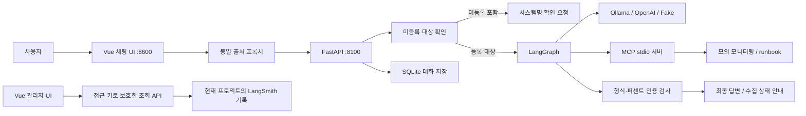
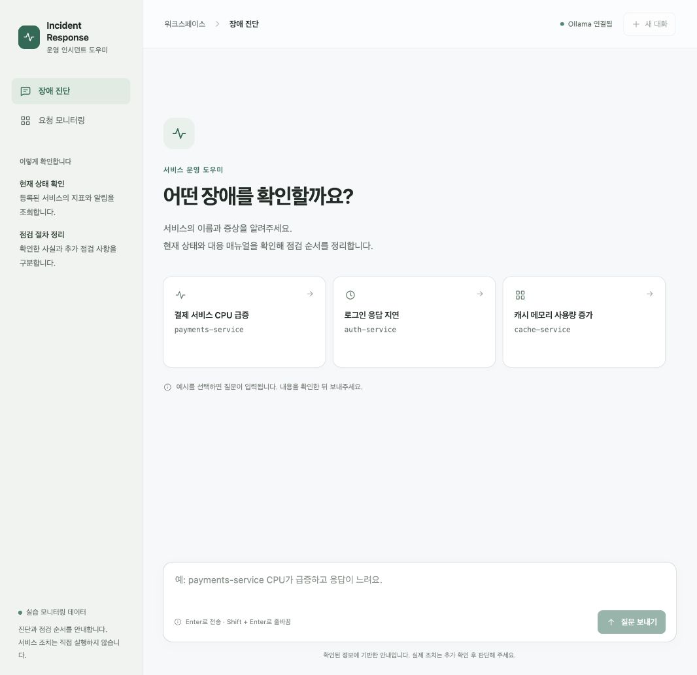
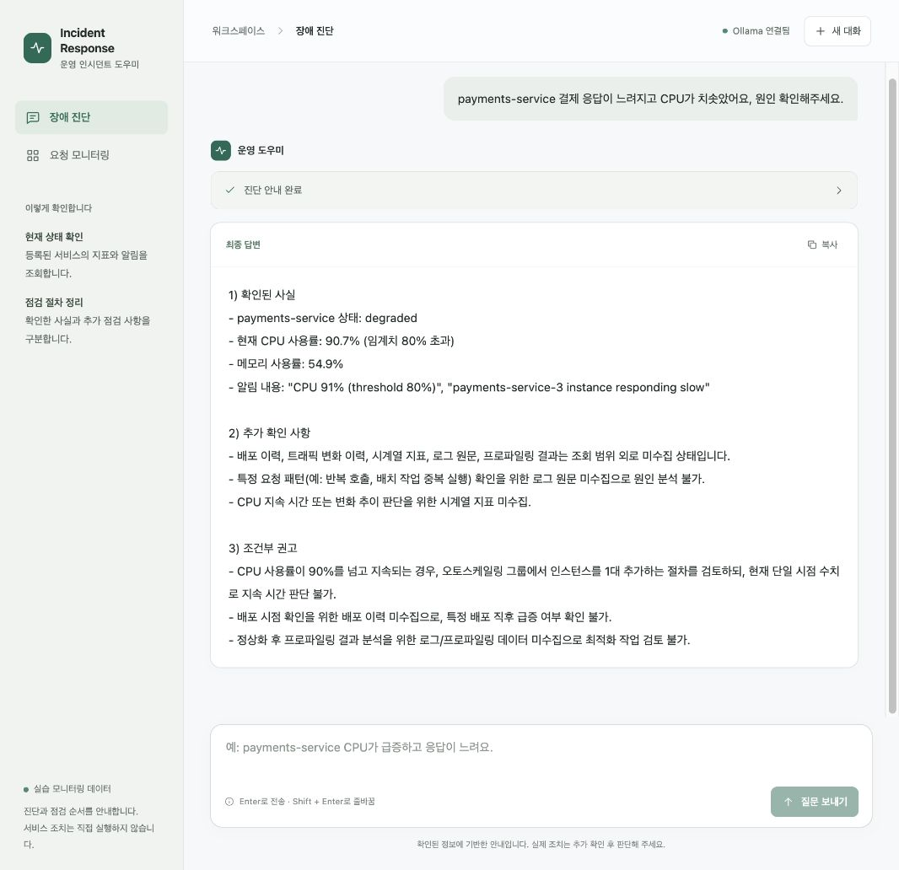

# Incident Response Agent 결과 보고서

**제공된 Base AI Agent의 대상 확인·답변 검증·관리자 화면 개선**

- 과제: SKALA AI Mini-Project 1번 — 제공된 Base AI Agent 개선
- 작성일: 2026-10-20
- 저장소: [jij0128/incident-response-agent](https://github.com/jij0128/incident-response-agent)
- 기준: 원본 `0672d14`, 구현 및 화면 개선 `af02f56`. 실험마다 실제 실행 소스 해시를 별도 보관했다.

## 1. 프로젝트 개요

사용자가 서비스 이름과 장애 증상을 입력하면 모니터링 상태와 대응 매뉴얼(runbook)을 조회하고 점검 순서를 안내하는 에이전트다. 제공된 코드를 실행하면서 미등록 시스템이 다른 시스템으로 대체되는 문제와, 매뉴얼의 지시가 이미 확인한 사실처럼 표현되는 문제를 발견했다. 이번 과제에서는 대상 확인, 근거 구분, 퍼센트 인용 검사와 실패 처리, 관리자 관측, 화면 사용성을 보완했다.

고정 사례에서 미등록 대상을 계속 조사하는 동작은 4/4건에서 0/4건으로, 근거 없는 퍼센트 초안의 검증 통과는 3/3건에서 0/3건으로 줄었다. 실제 Ollama 비교에서는 미등록 질문의 잘못된 대상 진단을 막았으나, 등록 질문의 처리 시간과 토큰은 증가했다. 이 결과를 전체 진단 정확도나 속도 향상으로 일반화하지 않는다.

**데이터는 실제 운영 환경의 관측값이 아니다.** `data/monitoring.json`에 기반한 모의 데이터이며 실시간 조회 시 CPU·메모리에 무작위 변동이 더해진다. 서비스 재시작·확장·롤백을 실제 실행하는 기능도 없다.

## 2. 제공된 구성과 이번 개선 범위

| 구분 | 내용 |
|---|---|
| 기존 제공 기능 | Vue CDN 채팅 UI, FastAPI API/프록시, LangGraph 계획·조사·재계획·분석·작성 흐름, MCP Tool/Resource/Prompt, SSE, SQLite 세션, Ollama/OpenAI/Fake 교체, LangSmith 추적 코드 |
| 직접 개선한 부분 | 미등록 대상 확인, 근거 종류와 도구 조회 범위 구분, 퍼센트 검사, 반복 실패 시 수집 상태 안내, 빈 스트림 업데이트 처리, 관리자 인증·조회 화면, 사용자 응답에서 내부 프롬프트 분리, 채팅 사용성 개선, 회귀 테스트와 비교 실험 |
| 이번에 추가하지 않은 부분 | MCP의 별도 네트워크 서비스화, RAG/벡터 DB, 운영 로그·배포 이력 수집, 실제 조치 실행, 사용자별 계정/권한 관리 |

RAG와 MCP 서비스 분리는 개선 후보의 예시로 이해했다. 이번에 재현한 문제는 대상 확인과 근거 해석·검증 경계에 있어 이를 우선했다. 기존 프레임워크 기능을 새로 구현한 성과로 계산하지 않는다.

## 3. 서비스 구조와 기술의 역할



| 기술 | 이 프로젝트에서 맡은 역할 |
|---|---|
| Vue 3·JavaScript·CSS | 질문 입력, SSE 결과 표시, 초안/최종 상태, 관리자 화면. CDN 방식이며 npm 빌드는 필요 없다. |
| FastAPI·Uvicorn | 요청 검증, API 제공, 앱 시작 시 의존성 생성·재사용, 프록시와 스트리밍 응답 |
| LangGraph | 대상 확인 → 분류 → 계획 → 작업 정리 → 조사 → 재계획 → 선택적 분석 → 작성 → 검증 → 완료의 상태 전이 |
| MCP·FastMCP | Tool로 동적 모니터링 조회, Resource로 정적 매뉴얼 조회, Prompt로 진단 절차 제공. 현재는 subprocess/stdio 연결이다. |
| HTTPX | 기존 코드의 Ollama/OpenAI HTTP 호출, 프론트 프록시, 관리자 조회 통신 |
| SQLite | 프로세스 밖에 대화 저장. 화면의 새 대화는 새 세션을 만들며 기존 DB를 삭제하지 않는다. |
| LangSmith | 추적을 켠 요청의 실행 트리와 지표 저장·조회. 관리자 조회와 사용자 진단을 구분한다. |
| unittest·Node test | Python API/그래프와 프론트 이벤트 처리 회귀 검사. Node는 테스트 실행에만 필요하다. |

UI와 데이터를 제공하는 API를 분리하는 것이 수업의 주요 목표였다. 현재 브라우저는 8600의 프록시를 통해 같은 출처로 요청한다. 브라우저가 8100을 직접 호출하는 구조가 아니므로 포트가 다르다는 이유만으로 CORS 허용을 추가하지 않았다.

## 4. 문제와 구현 내용

### 4.1 미등록 시스템을 다른 시스템으로 대체하는 문제

`billing-service 응답이 느려요`를 입력했을 때 원본은 기본 대상인 auth-service를 조사했다. 실제 모델 답변은 수집하지 않은 서비스 의존 관계까지 추정했다. 대상이 잘못되면 뒤의 매뉴얼과 문장이 형식 검사를 통과해도 요청에 맞는 진단이 아니다.

v2 그래프 앞에 `target_check`를 추가했다. 명시된 서비스/호스트 식별자를 등록 목록과 대조하고 미등록 이름이 있으면 LLM·MCP 호출 전에 시스템명 확인 안내로 종료한다. 등록·미등록 대상이 섞인 요청도 전체 진단을 보류한다.

검사 범위는 `-service`/`_service` 식별자와 숫자 접미사 호스트명이다. 별칭·대소문자 정규화·대상명 생략 시 기본값·legacy v1은 남은 범위다.

### 4.2 관측 사실, 매뉴얼, 모델 추정의 혼동

수집 결과를 하나의 ‘사실’ 목록으로 전달하면 매뉴얼의 로그 확인 지시를 로그 분석 결과처럼 표현할 수 있다. `agent/grounding.py`에서 두 실모델 백엔드의 작성 지시를 공통화했다.

- 모니터링은 관측 결과, runbook은 미실행 점검 절차, analysis는 미확정 모델 추정으로 나눈다.
- 답변은 확인된 사실 → 추가 확인 사항 → 조건부 권고 순서로 작성하도록 한다.
- 로그 미수집·지속시간 미확인을 명시하고 실제 확장/롤백을 수행했다고 표현하지 않도록 한다.
- 모니터링 도구의 반환 범위를 명시한다. 배포·트래픽 이력, 시계열, 로그, 프로파일링은 별도 자료가 필요하다. 매뉴얼이 이를 현재 도구로 확인하라고 지시해도 도구의 실제 범위를 우선한다.

이는 작성 지시의 개선이다. 모델이 모든 문장에서 항상 지시를 따르는지 코드로 보장하는 의미 검증기는 아니다.

### 4.3 형식만 검사하던 답변 검증과 강제 합격

기존 검사는 길이와 번호 표기만으로 판단했다. 퍼센트 인용이 모니터링 필드·알림·매뉴얼에 존재하는지 추가로 검사하고, 근거가 없으면 재작성 사유를 전달한다. 사용자 질문과 모델의 analysis는 숫자의 근거로 인정하지 않는다.

3회 검증 실패 후에는 잘못된 초안을 강제 합격시키지 않는다. 검증 실패로 남기고 코드가 수집된 상태만으로 구성한 안내를 반환한다. 현재 검사는 퍼센트의 존재 여부만 확인하므로 지표·시스템 귀속이나 시간 단위 오류까지 막지는 못한다.

### 4.4 스트리밍 중단과 관리자 관측

대상 확인 노드가 등록 대상을 통과시키며 상태 변경을 반환하지 않을 때 LangGraph 업데이트가 `None`이었다. 서버가 이를 일반 상태 변경으로 처리해 실제 화면의 스트림이 끊겼다. 빈 업데이트를 건너뛰고 일반/SSE API 회귀 테스트를 추가했다.

별도로 `/admin`과 접근 키로 보호된 조회 API를 추가했다. 현재 프로젝트의 최근 요청, 처리 시간·토큰, 검증 이력, 실행 트리, 최종 프롬프트를 조회한다. 다른 프로젝트의 실행 ID 접근은 거절한다. 내부 프롬프트는 일반 사용자 응답에서 제거했다. 추적이 꺼져 있으면 새 대화가 기록되지 않는다는 안내도 표시한다.

관리자는 단일 접근 키를 사용하는 실습 구성이다. 공개 운영을 위한 사용자별 인증/역할 체계를 구현한 것은 아니다. 추적을 켜면 질문·답변·프롬프트·실행 정보가 외부 LangSmith로 전송되므로 검증 중에는 기본적으로 꺼두었다.

### 4.5 사용자 화면 개선

예시 질문, 여러 줄 입력, 새 대화, 답변 복사를 추가했다. 전송 중 중복 submit과 한글 입력 조합 중 Enter를 막고, 연결 실패를 안내하며 질문을 다시 입력할 수 있게 했다. 검증 전 초안과 최종 답변을 구분하고 완료된 단계에 계속 대기 표시를 하지 않는다. 사용자가 위쪽 내용을 읽고 있으면 자동 스크롤을 멈춘다.

채팅과 관리자 화면을 밝은 중립색·초록색으로 맞췄고, 작은 화면 배치와 키보드 포커스·모션 감소 설정을 반영했다. [프론트엔드 개선 기록](frontend_improvements.md)에 화면과 구현 범위를 남겼다.

## 5. 검증 조건과 결과

### 5.1 고정 사례 기반 규칙 비교

`eval/compare_rules.py`는 원본 스냅샷과 개선본의 대상 확인·검증 노드를 별도 프로세스에서 실행한다. 대상 확인 7건, 초안 검증 8건(한계 2건 포함), 3회 반복 실패 1건을 고정 입력으로 비교했다. 실제 LLM이나 MCP 호출은 없다.

| 측정 항목 | 원본 | 개선본 |
|---|---:|---:|
| 미등록 대상인데 조사 흐름을 계속 진행 | 4/4 | 0/4 |
| 근거 없는 퍼센트 초안의 1차 검증 통과 | 3/3 | 0/3 |
| 정확한 퍼센트 인용 초안 통과 | 3/3 | 3/3 |
| 알려진 한계 사례의 잘못된 통과 | 2/2 | 2/2 |
| 3회 실패 후 처리 | 잘못된 초안 반환 | 수집 상태 안내 |

한계 사례는 메모리 수치를 CPU에 잘못 붙이거나 근거 없는 초 단위를 쓰는 경우다. 위 비율은 설계한 사례의 기대 동작 확인이며 전체 진단 정확도가 아니다. [원시 입력·결과와 소스 해시](../eval/results/rule_comparison.json), [비교표](../eval/results/rule_comparison.md)를 보관했다.

### 5.2 실제 Ollama 비교

동일 질문 3개를 원본·개선본에서 각 1회, 총 6회 실행했다. fast 모델은 qwen3:0.6b, quality 모델은 qwen3:8b였다. 모니터링 MCP 응답과 매뉴얼을 고정하고 매 측정 전 두 모델을 워밍업했다. 그래프와 실제 모델을 실행했지만 브라우저·웹 전달·SQLite·실제 MCP 전송은 포함하지 않았다.

| 질문 | 원본 | 당시 개선본 | 관찰 |
|---|---|---|---|
| 등록된 payments-service | 32.16초 / 2,027토큰 | 40.06초 / 2,414토큰 | 미확인 정보 표현은 명확해졌지만 시간·토큰 증가 |
| 미등록 billing-service | 54.30초 / 2,670토큰 | 0.0024초 / LLM 0회 | 원본은 auth-service 조회, 개선본은 이름 확인 |
| 등록·미등록 혼합 | 305.59초 후 ReadTimeout | 0.0022초 / LLM 0회 | 원본은 조사 후 분석 호출 실패, 개선본은 이름 확인 |

원본 혼합 질문의 1,169토큰은 성공한 route·plan만의 부분 합계다. 타임아웃이 난 analyze 호출의 사용량은 받지 못했으므로 전체 토큰으로 해석하지 않는다. 실패 시간을 성공 응답 시간과 합쳐 평균 내지 않는다.

등록 질문은 현재 CPU와 알림 CPU가 모두 91%인 고정 데이터였다. 이 실험만으로 두 값을 구분하는 능력을 판정하지 않았다. 양쪽 모두 새로운 퍼센트 오류나 재작성은 없었으므로 실모델의 수치 오류율 감소를 입증한 결과도 아니다. [실측 원문](../eval/results/ollama_comparison.md)과 [답변 검토](../eval/results/ollama_review.md)에 한계를 남겼다.

이후 도구 조회 범위 안내를 보완했다. 같은 고정 질문의 후속 실행 1건에서 배포 이력을 조회 범위 밖의 미수집 자료로 표시하고 별도 배포 기록을 요청했다. [후속 확인](../eval/results/tool_scope_check.md)은 워밍업 조건이 다른 단일 실행이므로 이전 실측과 속도를 비교하지 않는다.

### 5.3 자동 테스트와 실제 브라우저

- Python 자동 테스트 **23개**, 프론트 이벤트 테스트 **8개**가 통과했다. 모의 의존성으로 API/그래프/관리자와 중복 전송·IME·초안/최종 상태·오류·늦은 이벤트를 확인한다.
- 실제 Chrome → Vue/프록시 → FastAPI → MCP → Ollama 경로에서 등록·미등록·혼합 질문을 확인했다. 진행 단계·최종 답변·전송 버튼 복귀와 세션 메시지 6건 저장을 확인했다.
- 조회 범위 보완 후 화면에서 현재 CPU 94.3%와 알림 91%를 구분했다. 새 UI에서는 현재 CPU 90.7%와 알림 91%를 구분한 응답, 검증 전 초안 → 최종 답변 전환, 복사·Enter·새 대화를 확인했다. 서로 다른 모의 조회이므로 수치 자체를 성능 비교에 쓰지 않는다.
- 작은 화면의 실제 관측 CSS 폭 433px에서 가로 넘침이 없었다. 실제 휴대폰이나 전체 브라우저 호환성 검사까지 수행한 것은 아니다.





### 5.4 관리자 LangSmith 연동

사용자 승인 아래 `capstone-all-total-admin-check`에 모의 일반 요청 1건과 SSE 요청 1건을 저장하고 관리자 API로 조회했다. 각 요청에서 Fake 추정 토큰 217개, 실행 노드 42개, 검증 반려 후 재작성·합격 이력을 확인했다. 화면에 보인 평균 약 0.75초·합계 434토큰은 **모의 백엔드의 연동 결과**이며 실제 모델의 성능·사용량이 아니다.

새 관리자 UI 확인 시 현재 설정 프로젝트 `capstone-all-total`의 조회 결과는 0건이었다. 이전 모의 기록 프로젝트와 다르며, 기록이 있는 표·트리의 새 스타일은 실제 데이터로 시각 확인하지 못했다. 검증 과정에서 추적을 켜거나 모의 요청 외의 새 기록을 전송하지 않았다.

### 5.5 실제 OpenAI 최종 검증

2026-10-20 사용자 승인 후 `eval/check_openai.py`로 등록·미등록·혼합 질문을 확인했다. 실제 OpenAI(gpt-4o-mini/gpt-4o), 실제 MCP stdio, FastAPI ASGI SSE 경로를 사용했다. 브라우저·프록시는 포함하지 않았고 임시 SQLite를 사용해 기존 서버와 대화 DB를 유지했다. LangSmith 추적은 껐다.

| 질문 | 결과 | API 호출 | 소요 시간 |
|---|---|---:|---:|
| 등록된 payments-service | 검증 1회 합격, 최종 답변과 `[DONE]` 수신 | 4회 | 7.3942초 |
| 미등록 billing-service | 시스템명 확인 요청과 `[DONE]` 수신 | 0회 | 0.0057초 |
| 등록·미등록 혼합 | 시스템명 확인 요청과 `[DONE]` 수신 | 0회 | 0.0047초 |

실제 호출은 mini 3회와 quality 1회였으며 API가 반환한 입력·출력 합계는 **1,697토큰**이다. fast 700/quality 1,100 출력 토큰 상한과 최대 6회 호출 제한을 검증에만 적용했다. 앱의 기본 출력 설정은 변경하지 않았다. 실제 청구액은 조회하지 않았고 앱의 가상 단가로 대체하지 않았다.

수동 답변 검토에서는 현재 CPU 98.8%·메모리 58.9%와 알림의 CPU 91%/임계치 80%를 구분했고, 배포·트래픽 이력 및 로그 미수집을 표시했다. 확장과 롤백은 조건부 권고로 표현했다. 원인 확정·실제 조치 수행은 하지 않았다. 통과 기준은 경로 완료·검증 이벤트·대상 확인이며 모든 자연어 주장에 대한 자동 의미 검증은 아니다. 무작위 모의 데이터와 최초 재시도를 포함한 단일 실행이므로 고정 데이터 Ollama 비교와 모델 간 성능 비교를 하지 않는다. [실행 기록과 한계](../eval/results/openai_check.md), [호출별 토큰·SSE 이벤트](../eval/results/openai_check.json)를 보관했다.

## 6. 한계와 트레이드오프

| 항목 | 현재 한계 또는 비용 |
|---|---|
| 대상 확인 | 이름 규칙과 등록 목록을 이용한다. 별칭·이름 생략·v1 처리는 남아 있고 혼합 요청은 등록 대상의 진단도 보류한다. |
| 답변 검증 | 퍼센트 존재 여부 검사다. 수치의 지표/서비스 귀속, 초·시간 단위, 자연어 원인 단정, 도구 능력을 의미적으로 판정하지 못한다. |
| 데이터 | 모의 지표와 문서만 있다. 로그·배포·시계열 도구 없이 근본 원인이나 지속 여부를 확정할 수 없다. |
| 지연·비용 | 설명을 명확히 하는 지시와 긴 답변의 비용이 있다. 등록 질문에서 시간과 토큰이 증가했다. 가상 단가 비용은 실제 청구액이 아니다. |
| 스트리밍 | 검증 전 초안이 노출된다. UI 라벨로 구분하지만 노출 자체를 막지 않는다. OpenAI 호출부는 아직 non-stream 응답을 한 번에 콜백으로 전달한다. |
| 동시성·상한 | 기존 동기 HTTP 호출, 출력 토큰 상한 부재 등 운영상 보완 여지가 있다. 원본 타임아웃의 정확한 원인은 미확정이다. |
| 관리자 | 단일 키 방식이며 프로젝트 범위/실행 트리 200개 제한이 있다. 외부 기록 반영 지연과 프로젝트 설정을 고려해야 한다. |
| 실험 | 통제된 소수 사례다. 반복 수·시나리오를 늘리고 관측 조건을 명시해야 일반화된 판단을 할 수 있다. |

추가 개선 후보는 구조화된 지표 귀속 검증, 실제 로그·배포·시계열 도구, 별칭과 대상 누락 시 확인 질문, 출력·동시성 제어, 검증 이후 스트림 공개 정책이다. 문서 수가 늘어 선택 품질이 문제가 될 때 RAG를 검토할 수 있다.

## 7. 문제 해결 과정과 배운 점

1. **대상 오류는 문장 검증보다 먼저 막아야 한다.** 미등록 질문을 반복해 기본 대상 대체를 재현했고, 그래프 진입 경계에 확인 노드를 뒀다. 뒤에서 그럴듯한 문장을 생성해도 잘못 선택한 대상은 복구되지 않는다.
2. **그래프 단위 검사만으로 사용자 경험을 보장할 수 없다.** 새 확인 노드의 빈 업데이트가 실제 SSE를 끊었다. 서버가 이를 처리하도록 수정하고 화면이 쓰는 스트리밍 API까지 회귀 검사 범위에 넣었다.
3. **매뉴얼은 관측 결과도, 도구 기능 명세도 아니다.** 공통 작성 지시로 사실과 절차를 구분했지만 실제 비교에서 도구가 없는 이력을 조회하도록 안내하는 문제가 남았다. 조회 범위를 추가한 뒤 실제 모델과 화면에서 다시 확인했다.
4. **검수 통과의 의미를 좁게 정의해야 한다.** 길이와 번호 표기는 형식이고, 퍼센트 존재 여부도 부분 검사다. 실패 후 강제 합격을 없애고 자동 검사의 잔여 한계를 보고서에 드러냈다.
5. **실측은 불리한 결과와 실패도 포함해야 한다.** 등록 질문의 시간·토큰 증가, 분석 호출 타임아웃, 실패 호출 토큰의 미수집을 함께 기록했다. Fake 연동 지표, 규칙 실험, 실모델 비교, 실제 화면 확인을 나눠 해석했다.
6. **화면 상태도 신뢰성의 일부다.** 초안을 최종 답변처럼 표시하거나 연결 실패를 조용히 넘기면 사용자가 잘못 이해한다. 상태 라벨·오류 안내·중복 전송 방지와 입력 조합 처리를 보완했다.

## 8. 실행 방법과 제출 자료

상세 설치·실행은 [루트 README](../README.md)를 따른다. 기본 흐름은 아래와 같다.

```bash
bash sh/setup_venv.sh
cp -n .env.example .env
# .env의 실제 키를 설정하고, 추적 여부를 확인한다.
bash sh/setup_ollama.sh
bash sh/run_agent_ollma.sh
# 별도 터미널
bash sh/run_frontend.sh
```

사용자 화면은 `http://localhost:8600`, 관리자는 `/admin`이다. 제공 실행 스크립트는 기존 포트 프로세스를 종료하고 `session.db`를 초기화하므로 실행 동작을 이해한 뒤 사용한다. 실제 키와 `.env`는 커밋하지 않는다.

재현 명령:

```bash
.venv/bin/python3 eval/compare_rules.py
# 로컬 Ollama 실행 및 모델 설치 후: 결과 파일을 덮어쓰므로 기존 결과를 먼저 보존한다.
.venv/bin/python3 eval/compare_ollama.py
node --test tests/frontend_chat.test.cjs
LANGCHAIN_TRACING_V2=false LANGSMITH_TRACING=false \
  .venv/bin/python3 -m unittest discover -s tests -v
# 실제 과금·외부 전송을 승인한 경우에만 실행
.venv/bin/python3 eval/check_openai.py --run-paid-check
```

제출 예정일은 2026-10-22 오후 1시이며 Git 주소와 외부 접근 가능한 결과 보고서 주소를 공유 시트에 등록한다. 커밋·푸시와 공유 시트 작성은 사용자가 수행한다. 이 파일을 푸시한 후 보고서 주소는 `https://github.com/jij0128/incident-response-agent/blob/main/doc/PROJECT_REPORT.md`이다. 발표자료와 대본은 [발표 폴더](presentation/)에 둔다.

## 9. 근거 자료

- 과제 안내: 제공 강의자료 `15-01-AI Mini-Project.pdf` PDF 3페이지(일정), 13페이지(평가), 교수님 전사문 및 판서. 강의 원문·녹취는 저장소에 재배포하지 않는다.
- [규칙 비교](../eval/results/rule_comparison.md), [규칙 원시 결과](../eval/results/rule_comparison.json)
- [실제 Ollama 비교](../eval/results/ollama_comparison.md), [원시 결과](../eval/results/ollama_comparison.json), [후속 답변 검토](../eval/results/ollama_review.md)
- [도구 조회 범위 후속 확인](../eval/results/tool_scope_check.md)
- [실제 브라우저 검증](../eval/results/ui_verification/README.md)
- [프론트엔드 개선·검증](frontend_improvements.md)
- [실제 OpenAI 최종 검증](../eval/results/openai_check.md)
- [회귀 테스트 질문](regression_test_queries.md)
- [Emil Kowalski의 디자인 엔지니어링 스킬](https://github.com/emilkowalski/skills/blob/main/skills/emil-design-eng/SKILL.md): 화면 개선 참고. 본 프로젝트에 스킬을 전역 설치하거나 해당 저장소의 구현을 통째로 가져오지는 않았다.
