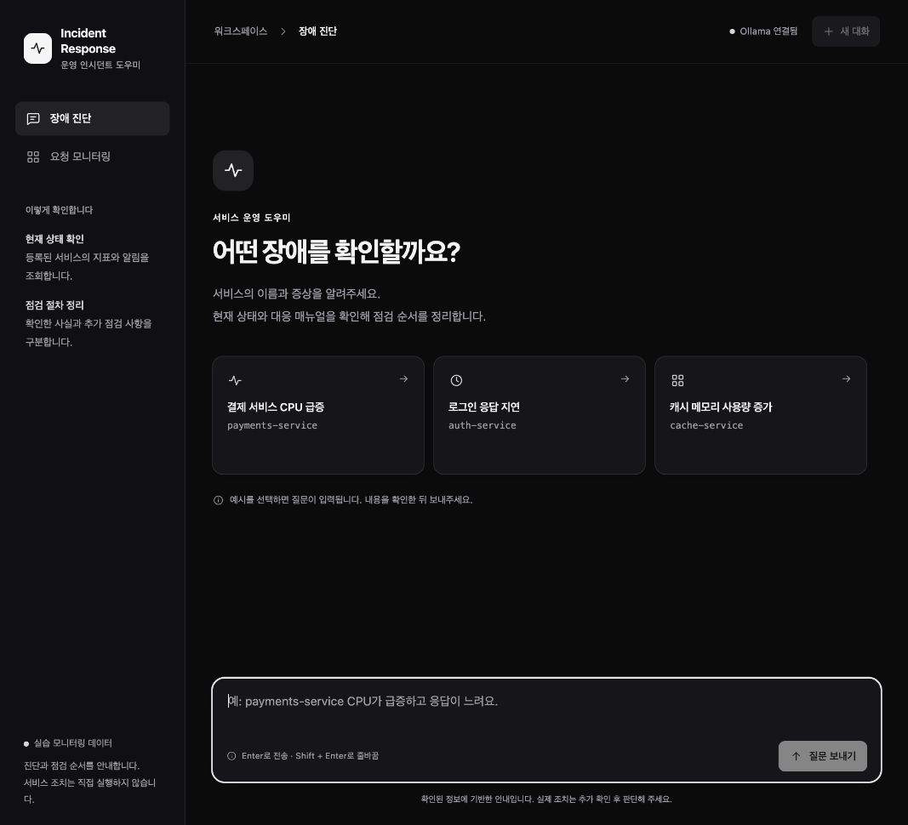

# 프론트엔드 사용성 개선

기존 Vue 3 CDN과 FastAPI 프록시 구조를 유지하고 `web_chat.html`, `admin.html`을 수정했다. 참고 자료는 [Emil Kowalski의 emil-design-eng 스킬](https://github.com/emilkowalski/skills/blob/main/skills/emil-design-eng/SKILL.md)이다. 스킬을 전역 설치하거나 애니메이션 라이브러리를 추가하지 않고, 현재 서비스에 필요한 지침을 적용했다.

## 현재 테마 — 2026-10-21

사용자 요청에 따라 채팅과 관리자 화면을 검정·흰색 중심의 다크 테마로 변경했다. 검정 배경, 짙은 회색 패널, 흰색 주요 버튼과 회색 보조 문구를 사용한다. 초록색 강조를 없애고 키보드 포커스, 입력창, 초안·최종 답변, 오류 안내, 관리자 표·실행 이력에도 같은 색상 변수를 적용했다. 브라우저의 기본 입력·스크롤 UI도 어둡게 표시하도록 `color-scheme: dark`와 `theme-color`를 지정했다. 테마 전환 토글은 추가하지 않았다.

기존 HTML 구조·반응형 배치·JavaScript는 유지했다. 프론트 이벤트 테스트 8개가 통과했고, 실제 Chrome과 기존 Ollama 서버에서 등록 질문의 최종 답변·입력창 복귀, 작은 화면의 미등록 대상 확인 안내를 확인했다. 관리자 표·상세·검증 이력·실행 트리·프롬프트·잘못된 키 오류는 별도 로컬 모의 공급자로 확인했다. 관리자 모의 화면의 2.40초·1,200토큰은 화면 확인용 값이며 실제 모델 측정이 아니다.

모바일 검사는 요청 뷰포트 390×844, 실제 관측 CSS 폭 433px에서 수행했다. clientWidth와 scrollWidth가 모두 433px으로 가로 넘침이 없었으며 임시 뷰포트는 복구했다. 실제 휴대폰이나 전체 접근성 인증 검사는 아니다. 등록 질문의 현재 CPU는 90.3%·메모리 54.6%였고 알림 CPU 91%와 구분했다. 이 실행은 테마 변경 후 동작 확인이며 전후 성능 비교가 아니다. 기존 서버·대화 DB·추적 설정을 유지했고 OpenAI 호출이나 LangSmith 추가 전송은 하지 않았다.



- [답변 화면](../eval/results/dark_theme_review/chat_result.png)
- [작은 화면](../eval/results/dark_theme_review/chat_mobile.png)
- [미등록 대상 확인 안내](../eval/results/dark_theme_review/chat_clarification.png)
- [관리자 표·상세 — 로컬 모의 데이터](../eval/results/dark_theme_review/admin_desktop.png)
- [검증 기록과 범위](../eval/results/dark_theme_review/verification.json)

아래의 밝은 화면과 초록색 강조는 2026-10-20의 1차 개선 기록이다. 당시 결과를 보존하며 현재 테마의 근거와 구분한다.

## 바뀐 점

| Before | After | 이유 |
|---|---|---|
| 빈 채팅 화면과 한 줄 입력 | 예시 질문 3개, 여러 줄 입력, 새 대화 | 서비스 이름과 증상을 어떻게 입력할지 안내 |
| 완료된 단계에도 모래시계 표시 | 진행 중 표시와 완료 상태를 구분하고 단계는 펼쳐서 확인 | 완료한 작업을 계속 대기 중으로 오해하지 않도록 |
| 스트리밍 초안이 일반 답변처럼 노출 | `작성 중인 초안 · 검증 전`과 최종 답변 구분, 반려 초안은 별도 접기 | 검증 전 내용을 확정 결과로 오해하지 않도록 |
| 전송 버튼만 비활성화 | 전송 함수에서도 중복 요청 차단, 한글 조합 Enter 제외 | 키보드 제출이나 중복 호출로 요청이 겹치지 않도록 |
| 연결 오류 시 안내 없이 종료 | 오류 표시, 미완성 초안 보존, 질문 다시 입력 | 실패를 알리고 사용자가 확인 후 재시도하도록 |
| 모든 토큰 수신 때 강제 스크롤 | 최신 답변을 따라가는 상태에서만 자동 이동 | 이전 내용을 읽는 위치를 유지하도록 |
| 답변을 직접 선택해 복사 | 복사 버튼과 성공/실패 피드백 | 결과를 보고서나 메모에 옮기기 쉽게 |
| 어두운 채팅·관리자 화면 | 밝은 중립색, 초록색 강조, 읽기 편한 폭과 여백 | 화면 사이의 일관성과 가독성 개선 |
| 추적이 꺼져도 채팅 후 조회하라는 빈 상태 | 현재 추적 상태에 맞춰 새 대화가 기록되지 않음을 안내 | 잘못된 다음 행동 안내 방지 |

버튼은 포인터로 누를 때만 짧게 반응하고 키보드 포커스를 표시한다. 호버 효과는 포인터 장치에 한정하며, 모션 감소 설정에서는 회전과 누름 효과를 제거한다. 새 메시지나 토큰마다 등장 애니메이션을 추가하지 않았다.

## 검증

```bash
node --test tests/frontend_chat.test.cjs
LANGCHAIN_TRACING_V2=false LANGSMITH_TRACING=false \
  .venv/bin/python3 -m unittest discover -s tests -v
```

- 프론트엔드 동작 테스트 **8개 통과**: 중복 전송, IME/Shift+Enter, 재작성과 최종 응답, 확인 요청/fallback, 최종 답변 없는 종료, 연결 실패와 늦은 이벤트, 답변 수신 후 연결 오류, 예시·복사·새 대화 세션을 확인했다. 실제 인라인 JS를 가짜 Vue 래퍼/EventSource에서 실행하며 외부 API는 호출하지 않는다.
- 기존 백엔드 자동 테스트 **23개 통과**. 마지막 관리자 빈 상태 문구는 이후 실제 브라우저에서 추가 확인했다.
- Chrome에서 실제 Vue/CDN과 프록시·MCP·Ollama 경로로 등록 질문 1회, 미등록 질문 1회, 혼합 질문 1회를 확인했다. 등록 질문의 토큰 수신 중 `검증 전 초안` 표시와 완료 후 `최종 답변` 전환을 관찰했다. 현재 CPU 90.7%와 알림 91%를 구분한 답변을 받았다.
- 예시 클릭은 입력만 하고 자동 전송하지 않았고, 답변 복사 피드백, Enter 전송, 새 대화 복귀도 확인했다. 미등록·혼합 질문은 확인 요청 카드로 종료했다.
- 작은 화면에서 세로 카드 배치와 입력창을 확인했다. 브라우저 뷰포트 설정은 390×844였고 페이지에서 관측한 CSS 폭은 433px이었다. 문서의 clientWidth와 scrollWidth가 모두 433px으로 가로 넘침이 없었다. 검사 후 뷰포트 설정을 초기화했다. 실제 휴대폰 검사는 아니다.
- 관리자 키 오류 안내와 인증 후 현재 프로젝트의 빈 화면을 확인했다. 조회는 기존 기록의 읽기만 수행했다. 현재 `capstone-all-total` 프로젝트는 조회 결과 0건이며, 이전 모의 검증의 `capstone-all-total-admin-check` 프로젝트와 다르다. 추적을 켜거나 새 기록을 전송하지 않았다. 확인 후 관리자 연결을 해제했다.

## 화면

이전 화면: [기존 실제 UI 캡처](../eval/results/ui_verification/registered.jpg)

새 시작 화면:


새 답변 화면:


작은 화면과 관리자:

- [모바일 배치](../eval/results/frontend_review/chat_mobile.jpg)
- [미등록·혼합 확인 요청](../eval/results/frontend_review/chat_clarification.jpg)
- [관리자 화면](../eval/results/frontend_review/admin_desktop.jpg)

## 범위와 한계

- 백엔드 진단 로직·API·관리자 인증·추적 설정은 변경하지 않았다. 디자인 변경이 모델 정확도나 추론 시간을 개선한 것은 아니다.
- 검증 전 초안은 계속 화면에 표시한다. 라벨로 구분하는 개선이며, 미검증 내용의 노출 자체를 막은 것은 아니다.
- 오류와 재작성 분기의 JS 동작은 모의 이벤트로 검증했다. 실제 모델로 모든 오류/재작성 상황을 재현하지는 않았다.
- 관리자 화면에서 기존 기록이 있는 표·실행 트리의 새 스타일은 실제 데이터로 시각 확인하지 못했다. 기존 조회/인증 테스트는 통과했다.
- 단일 브라우저와 소수 사례의 기능 확인이다. 전면적인 접근성 인증이나 전체 기기 호환성을 검증한 것은 아니다.
- 기존 외부 Vue CDN 의존성은 유지했다. Node는 새 동작 테스트 실행에만 사용하며 서비스 실행에 npm 설치나 빌드는 필요 없다.
