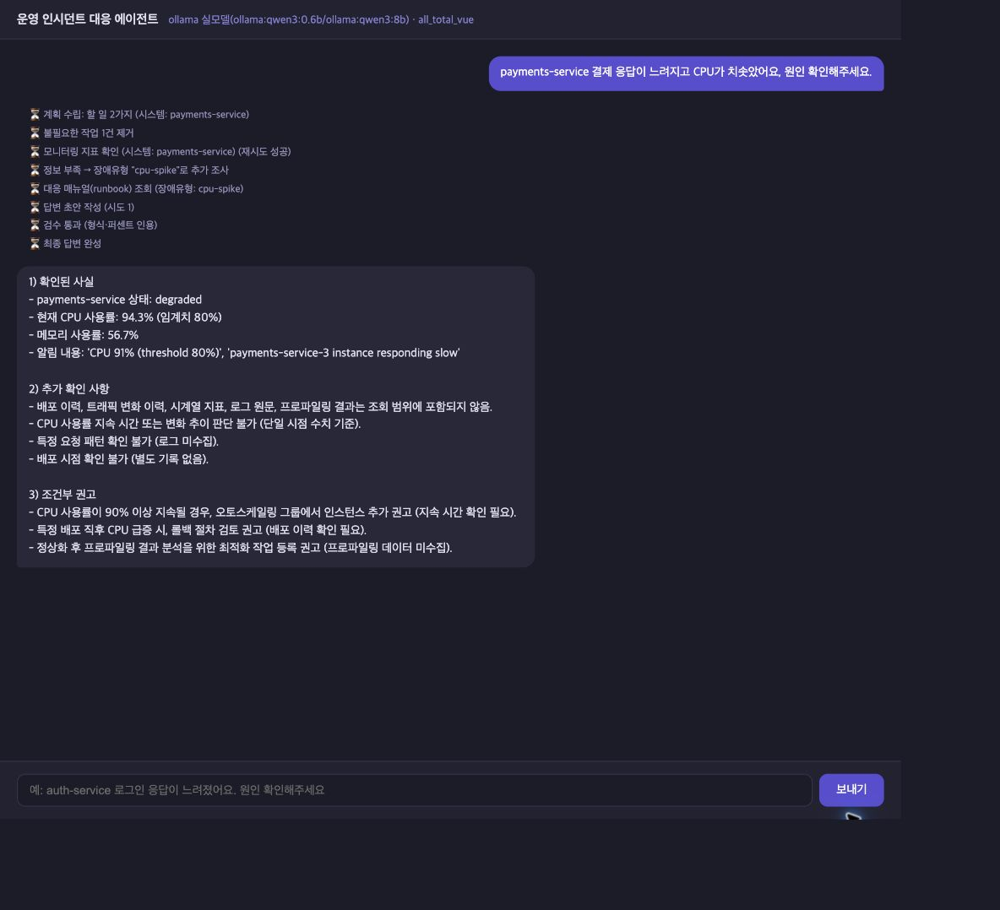
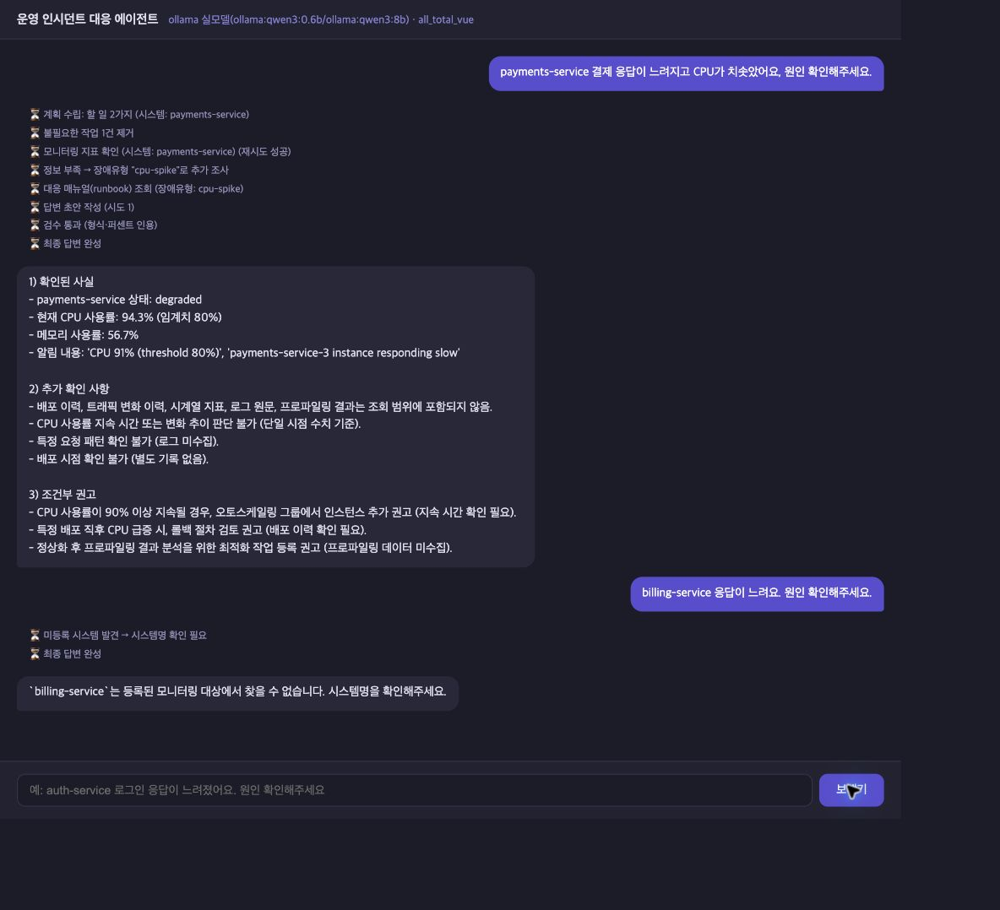
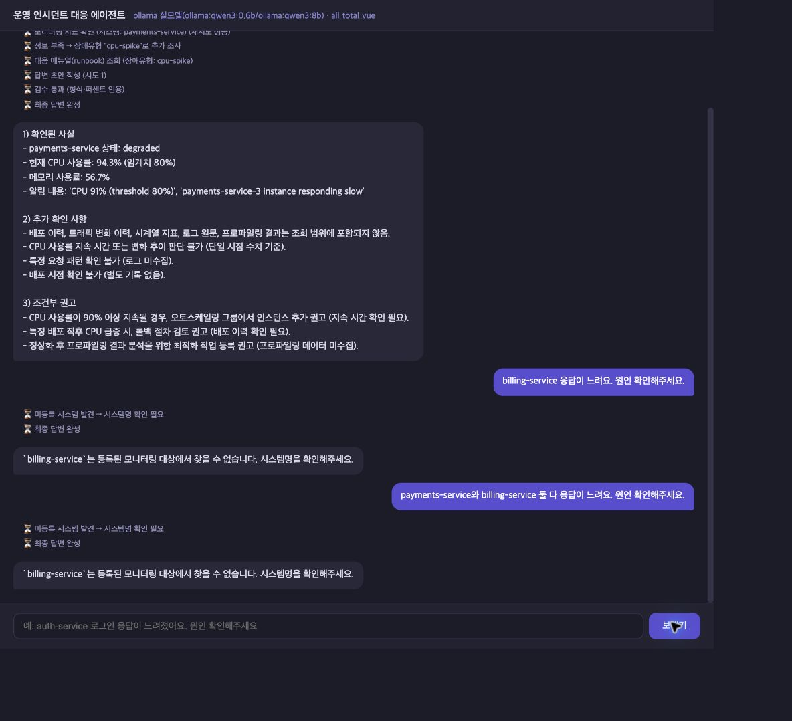

# 실제 브라우저 화면 검증

2026-10-20, 커밋 `f4b2831cd3141bef5bebda5bbd186054809335bc`의 사용자 채팅 화면을 Chrome의 별도 탭에서 확인했다. 제품 코드는 추가 수정하지 않았다.

## 실행 조건

- Vue 화면 및 프록시 `http://localhost:8600` → FastAPI `127.0.0.1:8100` → 실제 MCP stdio 서버 → 로컬 Ollama `qwen3:0.6b`/`qwen3:8b` 경로를 사용했다.
- 백엔드를 최신 코드로 재시작했다. 기존 실행 스크립트가 함께 종료한 Ollama 서버도 다시 시작했다. `session.db`를 삭제하거나 `.env`를 수정하지 않았다.
- 백엔드 프로세스의 `LANGCHAIN_TRACING_V2=false`, `LANGSMITH_TRACING=false`를 명시해 LangSmith 전송을 껐다. 실제 OpenAI API는 호출하지 않았다.
- 이전 고정 입력 비교와 달리 실제 MCP의 모의 모니터링 데이터를 사용했다. CPU/메모리 무작위 변동과 첫 호출 재시도를 포함하므로 이전 실측과 속도·수치 개선률을 비교하지 않는다.
- 새 브라우저 탭의 독립 대화 세션에서 세 질문을 순서대로 보냈다. 다른 사용자 탭의 대화는 조작하지 않았다.

## 확인 결과

| 질문 | 실제 화면 응답 | 결과 |
|---|---|---|
| `payments-service 결제 응답이 느려지고 CPU가 치솟았어요, 원인 확인해주세요.` | payments-service 진단. 현재 CPU 94.3%/메모리 56.7%, 알림 CPU 91%를 구분. 배포·트래픽 이력/시계열/로그/프로파일링을 조회 범위 밖으로 표시하고 지속 여부 확인 후 확장·롤백을 검토하도록 안내 | 기대 동작 확인 |
| `billing-service 응답이 느려요. 원인 확인해주세요.` | 조사 단계 없이 billing-service 미등록 안내와 시스템명 확인 요청 | 기대 동작 확인 |
| `payments-service와 billing-service 둘 다 응답이 느려요. 원인 확인해주세요.` | billing-service 확인 요청으로 전체 진단을 보류 | 기대 동작 확인 |

등록 질문은 답변이 나오기 전에 계획·모니터링 재시도 성공·매뉴얼 추가 조사 단계가 화면에 표시됐다. 완료 시 초안 1회, 형식·퍼센트 검수 통과, 최종 답변 완성을 확인했다. 세 질문 모두 최종 응답이 표시되고 전송 버튼이 다시 활성화됐다. 사용자 화면에 내부 프롬프트는 나타나지 않았다.

브라우저 답변과 해당 테스트 세션의 SQLite 저장 내용이 일치했다. 질문·답변 각 3건, 총 6개 메시지가 저장됐다. 확인 시점 백엔드 로그의 `ERROR:` 항목은 0건이었다.

## 화면 증거

등록 질문 완료 화면:

미등록 질문 완료 화면:

혼합 질문 완료 화면:

## 원시 기록과 한계

- [브라우저 관측 기록](browser_observations.json): 질문, 화면 접근성 텍스트, 캡처 파일명.
- [검증 메타데이터](verification.json): 커밋, 모델·서버 상태, 테스트 세션의 저장 답변, 소스·이미지 SHA-256.
- 단일 브라우저에서 사례당 1회 확인했다. 전체 서비스의 정확도·성능이나 모든 입력의 성공을 보장하는 결과가 아니다.
- 스트리밍은 진행 단계 표시, 최종 답변 표시, 전송 버튼 복귀로 확인했다. 토큰별 갱신의 중간 화면과 원시 SSE `[DONE]` 패킷은 별도로 수집하지 않았다.
- 배포 이력·시계열·로그를 실제로 수집하는 기능이나 자연어 의미 검증을 추가한 것은 아니다. OpenAI 실모델 검증도 남아 있다.
